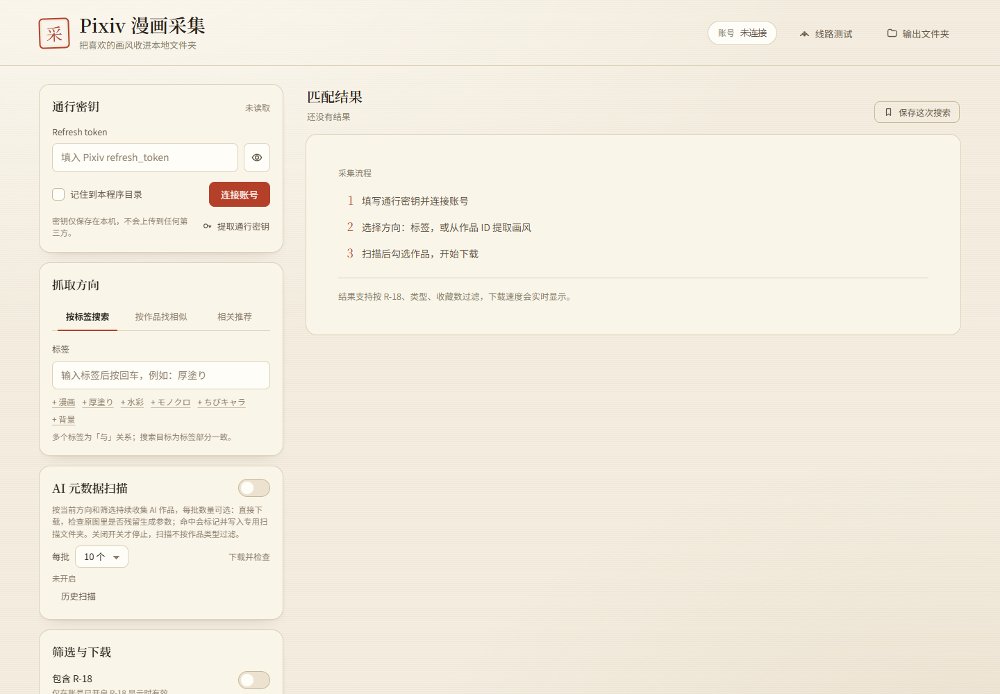

# Pixiv 漫画采集器

一个跑在本机的 Pixiv 漫画采集小工具：填写通行密钥后，可以按标签搜索、按作品找相似、沿相关推荐一层层往下找；支持 R-18、收藏数、作品类型筛选，下载时实时显示速度。还带 AI 元数据扫描、LSB / Alpha 隐写深扫、线路测速、代理设置和历史扫描。

> 本项目是非官方工具，与 Pixiv 没有关系。仅限个人学习、备份自己账号可访问的内容，请遵守 Pixiv 服务条款和当地法律，不要传播受版权保护的作品。



## 功能

- **三种抓取方向**
  - 按标签搜索：多个标签为「与」关系，支持漫画/插画/全部。
  - 按作品找相似：从种子作品提取画风标签并加权排序。
  - 相关推荐：从种子作品沿 Pixiv `/v2/illust/related` 队列一层层展开，可以「下一批」继续，不重复。
- **下载**
  - 原图下载，实时 MB/s、页/秒、剩余时间、速度曲线。
  - `.part` 断点续传；失败重试队列；已下载作品可跳过。
- **AI 元数据扫描**
  - 按当前方向持续收集 AI 作品，每批 5/10/20/30/50 个，下载后检查原图。
  - 识别 PNG 文本块、JPEG EXIF/XMP、ComfyUI workflow、NovelAI Comment JSON。
  - 安装 Pillow 后额外做 LSB / Alpha 隐写深扫（NovelAI `stealth_pngcomp` / `stealth_pnginfo`、RGB LSB 等）。
  - 命中作品隔离到「命中作品」目录，显示暴露等级、暴露描述和原始字段；支持历史扫描、搜索、分页、导出 CSV/JSON。
- **下载库**
  - 扫描本机 `output/`，查看已经下载的作品和每一页原图。
  - 按标题/ID/标签/作者搜索，按来源、类型、R-18、元数据命中、标签、作者、扫描会话筛选。
  - 支持按作者、标签、月份、来源、命中情况、类型分组查看。
  - 内置图片查看器：翻页、缩略图、键盘左右键、打开作品文件夹、跳转 Pixiv。
- **通行密钥**
  - 支持一键登录窗口（pywebview + WebView2，登录后自动抓取 `pixiv://` 回调）。
  - 支持手动粘贴授权码/回调 URL。
  - 支持从本机 gppt、pixiv-token-getter、旧密钥文件等常见位置导入。
- **网络**
  - 跟随系统代理 / 直连 / 自定义 HTTP 代理。
  - 线路测试：分别测直连和当前线路的 API 延迟、CDN 下载速度。
- **本机安全**
  - 只监听 `127.0.0.1`。
  - API 带一次性 Token 和 Host/Origin 校验。
  - 密钥默认只保存在内存，勾选「记住」才会写入程序目录。

## 环境要求

- Windows 10/11（其他系统可手动运行，但一键登录窗口依赖 WebView2/pywebview）
- Python 3.10+
- `requests`
- 可选：`Pillow`（LSB / Alpha 深扫）
- 可选：`pywebview`（一键登录窗口）

```bash
python -m pip install -r requirements.txt
# 可选
python -m pip install pillow pywebview
```

## 启动

```bash
python server.py --open
```

或者双击 `启动.bat`。默认地址：<http://127.0.0.1:8765>。

常用参数：

```bash
python server.py --port 8765 --key-file "C:\path\pixiv_通行密钥.json" --open
```

## 通行密钥

密钥文件格式：

```json
{
  "account": "user_xxxxxx",
  "refresh_token": "你的 refresh_token"
}
```

程序会按以下顺序查找：

1. `--key-file` 指定的路径；
2. 程序目录下的 `pixiv_通行密钥.json`；
3. 桌面 `api/pixiv_通行密钥.json`（`~/Desktop/api/...`）；
4. 程序目录的 `config.json`。

也可以直接在页面里点「提取通行密钥」：一键登录、手动粘贴或从本机工具缓存导入。

> 不要把 `pixiv_通行密钥.json`、refresh_token 或 `settings.json` 提交到 Git 仓库、截图或发给别人。

## 目录

```text
Pixiv漫画采集器/
├─ server.py              本地后端：Pixiv API、下载、扫描、设置
├─ metadata_inspect.py    图片元数据检查（纯标准库 + 可选 Pillow 深扫）
├─ token_login.py         一键登录窗口（pywebview，可选）
├─ web/                   米白色单页界面
├─ 启动.bat               Windows 启动脚本
├─ requirements.txt
├─ docs/preview.png       安全截图
├─ output/                下载结果（运行时生成，不提交）
├─ settings.json          设置（运行时生成，不提交）
└─ logs/                  日志（运行时生成，不提交）
```

## 设置

右上角「线路测试」打开网络与设置，可以修改：
- 代理模式、代理地址；
- 下载超时、API 最小间隔；
- 默认每批数量、最大批次、最大磁盘占用；
- 命中浏览器通知。

设置保存到程序目录的 `settings.json`，日志在 `logs/app.log`。

## 下载库

右上角「下载库」会扫描本机 `output/`：

- 普通下载、AI 扫描批次、命中隔离作品都会汇总；
- 搜索标题 / ID / 标签 / 作者；
- 筛选来源、类型、R-18、命中情况、标签、作者、扫描会话；
- 按作者、标签、月份、来源、命中情况、类型分组；
- 点卡片进入图片查看器，支持翻页、缩略图、键盘左右键、打开文件夹和跳转 Pixiv。

下载库只读本地文件，不会上传图片；删除文件请到 `output/` 里手动操作。

## 开发检查

```bash
python -m py_compile server.py metadata_inspect.py token_login.py
node --check web/app.js
```

## 已知限制

- 相关推荐 API 对部分作品可能返回空；如果所有种子都被 R-18/筛选条件排除，会提示没有可用种子。
- 相关推荐可能展开很多层，开始后需要一点时间才能凑满一批 AI 作品。
- 有损 WebP 会破坏 LSB，隐写深扫只对无损图片有效；超大图会跳过深扫。
- 一键登录依赖 Windows WebView2 和 pywebview；不可用时仍可手动粘贴或导入。

## 隐私与免责声明

- 本项目不会把密钥上传到第三方；所有请求都在本机发起。
- 请只登录自己的 Pixiv 账号，不要分享、出售或批量传播下载内容。
- 请遵守 Pixiv 的服务条款、API 使用规则和当地法律；因使用本项目产生的账号或法律风险由使用者自行承担。
- 项目不包含任何作品图片、用户密钥或私人数据。

## 许可证

[MIT](LICENSE)

## 致谢

- 通行密钥 OAuth2 PKCE 流程参考 [gppt](https://github.com/eggplants/get-pixivpy-token)。
- 凭据缓存导入思路参考 [pixiv-token-getter](https://github.com/redtidev1918/pixiv-token-getter)。
- LSB / Alpha 隐写格式参考 NovelAI 官方元数据工具与公开实现。
- 感谢所有提交 Issue / PR 的使用者。
